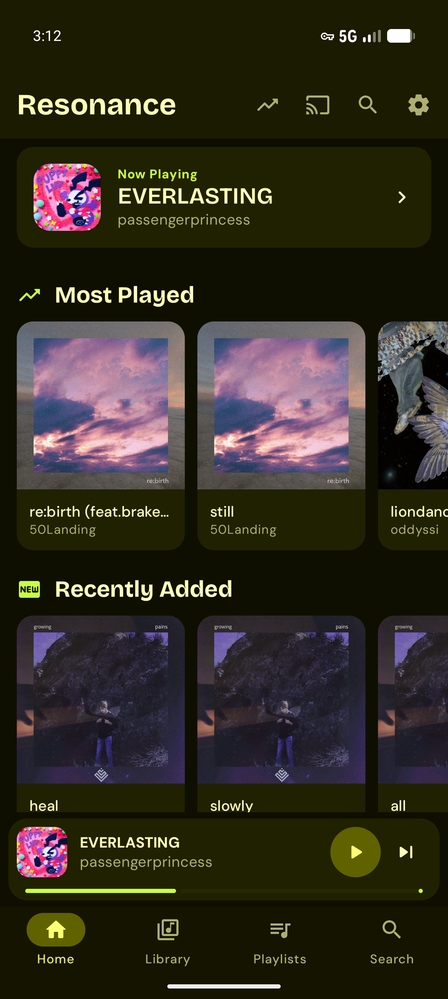
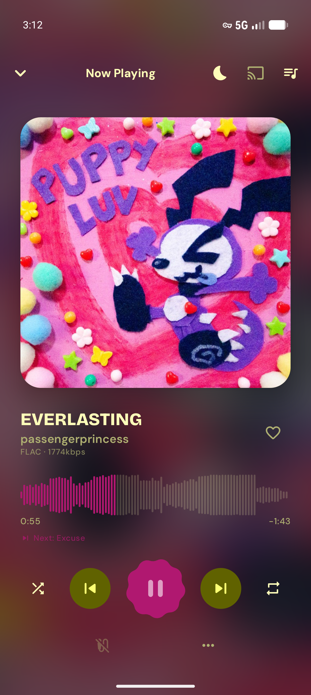
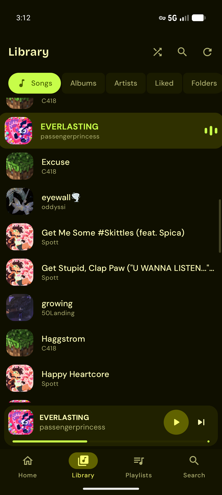
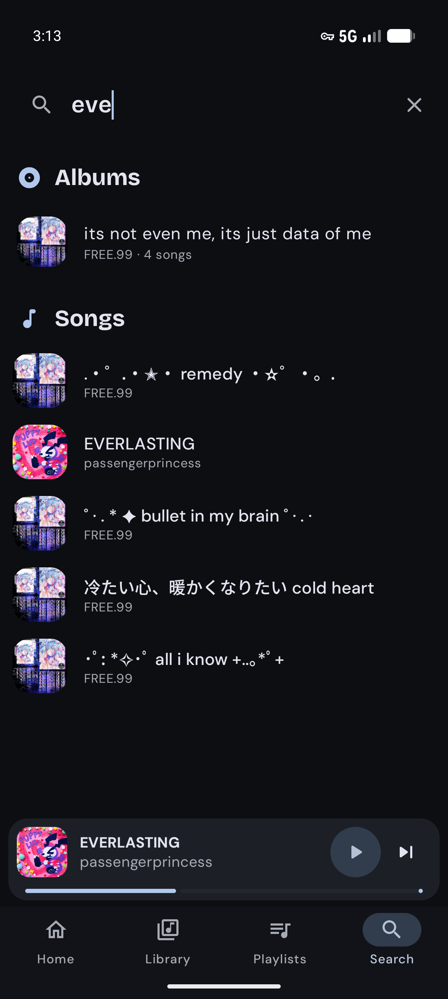
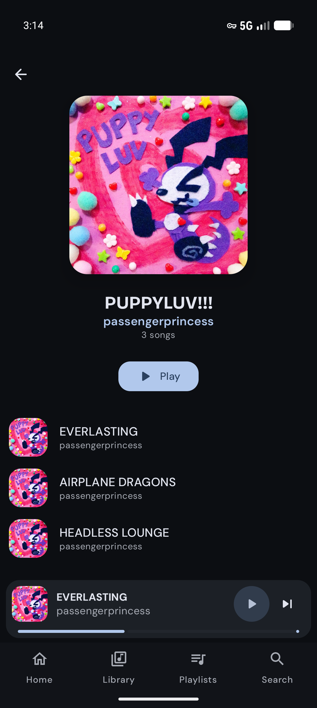
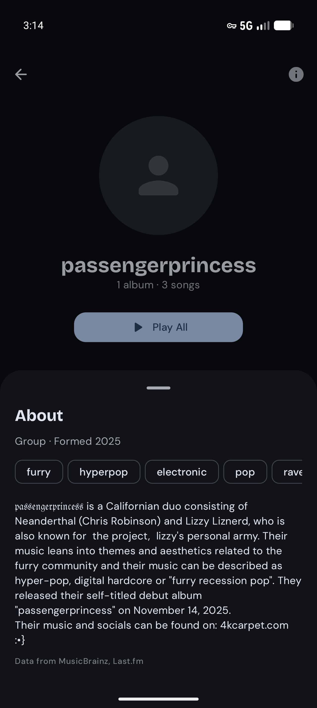
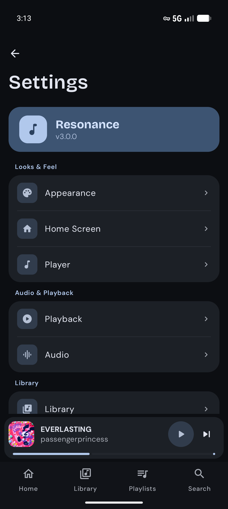
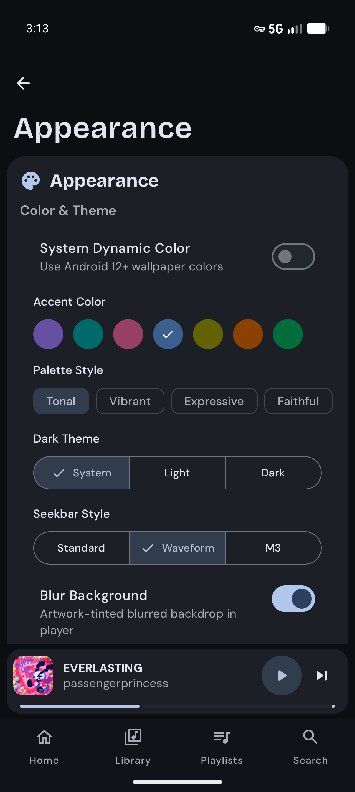

> [!IMPORTANT]
> The updates for this app will be slower due to me attending a university, thanks for understanding and supporting this project! <3

> [!NOTE]
> Please join my Discord server, I'm currently looking for testers so I can release the app on Google Play as well, thank you!! https://discord.gg/SftqvvveMj


<div align="center">
  <h1>Resonance</h1>
  <p>A modern, feature-rich music player for <b>Android 8.0 and newer</b>: local files and Navidrome</p>
  <p>Inspired by <a href="https://github.com/namidaco/namida">Namida</a>, <a href="https://github.com/theovilardo/PixelPlayer">Pixel Player</a> & <a href="https://github.com/FoedusProgramme/Gramophone">Gramphone</a> 💜</p>

  -3DDC84?logo=android&logoColor=white)
  
  
  

  <h3>Available on</h3>
  <a href="https://rookieenough.github.io/Orion-Data/redirect.html?id=resonance"></a>
  <a href="https://github.com/yuw1xx/resonance-app/releases/latest"></a>
</div>

---

## Overview

Resonance is a powerful local music player built entirely with Kotlin and Jetpack Compose. Designed for audiophiles who want full control over their listening experience — from ReplayGain and crossfade to synced lyrics, Last.fm scrobbling, Navidrome streaming, and peer-to-peer song sharing. No ads, no subscriptions, completely FOSS forever.

## Screenshots

| Home | Player | Library | Search |
| :---: | :---: | :---: | :---: |
|  |  |  |  |

| Album | Artist | Settings | Appearance |
| :---: | :---: | :---: | :---: |
|  |  |  |  |

## Features

### Playback
- [x] **Gapless playback** — seamless transitions using ExoPlayer's native gapless support
- [x] **Crossfade** — configurable crossfade duration between songs
- [x] **ReplayGain 2.0** — per-track and per-album volume normalization with configurable preamp
- [x] **Skip silence** — automatically skip silent passages
- [x] **Playback speed & pitch control** — independent speed and pitch adjustment
- [x] **Smart shuffle** — history-aware shuffle that avoids repeating recently played tracks
- [x] **Sleep timer** — minutes, tracks or end of the current song, with an optional fade-out
- [x] **Reliable background playback** — keeps playing, scrobbling and recording history with the app closed; proper audio focus (pauses for calls)

### Library
- [x] **Full MediaStore integration** — automatically detects all local audio files
- [x] **Configurable artist delimiters** — split multi-artist tags the way you want
- [x] **Folder browsing** — navigate your music by directory
- [x] **Excluded folders** — hide folders from the library
- [x] **Auto-scan** — scheduled background library refresh
- [x] **Sort & filter** — sort by title, artist, album, date added, duration, play count, and more
- [x] **Persistent queue** — queue survives app restarts; drag to reorder, swipe to remove, save as playlist, undo
- [x] **Playlists** — M3U/M3U8 import, export, and two-way **folder sync** (works with Syncthing, SD cards…)
- [x] **Smart playlists** — live rules on artist, genre, year, play count, last played, date added, length, liked…

### Streaming
- [x] **Navidrome / Subsonic** — browse, play and scrobble from your self-hosted server; the library is cached and only re-synced when the server actually changed; streamed audio is cached on disk
- [x] **Chromecast** — cast to any Google Cast device directly from the player

### Lyrics
- [x] **Synced lyrics** — LRC with word-by-word karaoke, translations, instrumental breaks and offsets; tap a line to seek
- [x] **Many sources** — embedded tags, `.lrc` files next to your music, your Navidrome server, and LRCLIB (opt-in)
- [x] **Lyrics editor** — edit, search, and sync by tapping along with the song

### Metadata & Artwork
- [x] **Tag editor** — edit title, artist, album, genre, year, track number, and more
- [x] **Artwork fetching** — automatic album art from MediaStore and online sources
- [x] **Artist images** — artist photos fetched from the Deezer API
- [x] **Waveform seekbar** — real-time waveform visualization extracted from the audio file

### Scrobbling
- [x] **Last.fm** — automatic scrobbling, now playing updates, and loved track sync
- [x] **Maloja** — self-hosted scrobbling via the Maloja API

### Mixes
- [x] **Auto-generated playlists** — weekly mixes built from your listening history (top artist, top genre)
- [x] **Navidrome mixes** — mix generation works with your Navidrome library too

### Statistics
- [x] **Listening history** — track your most played songs and artists over time
- [x] **Play breakdowns** — see when you listen most, by hour and time period

### Sharing
- [x] **Resonance Share** — send songs to nearby devices over Wi-Fi (Nearby Connections), or anywhere via a self-hostable relay with resumable downloads (`server/resonance-share`)

### Backup
- [x] **Playlist & liked song backup** — export and import as JSON

### Equalizer
- [x] **System equalizer** — access and control EQ presets from within the app

### UI & Customization
- [x] **Material 3 Expressive** — Material You dynamic color with real tonal palettes, expressive motion and shapes, a draggable Now Playing sheet with predictive back
- [x] **Preset colors** — choose from a set of curated accent colors
- [x] **Dark / Light / System theme** — follows system or manual override
- [x] **Blur artwork background** — blurred album art as the player background
- [x] **Artwork animation** — rotating vinyl / artwork animation while playing
- [x] **Configurable corner radius** — round or sharp UI corners
- [x] **Mini player styles** — choose your preferred mini player layout
- [x] **Player layouts** — multiple full-screen player designs
- [x] **Haptic feedback** — tactile response on controls

### Home Screen Widget
- [x] **Now-playing widget** — displays the current song title and artist on your home screen
- [x] **Playback controls** — play/pause and skip directly from the widget
- [x] **Live updates** — widget stays in sync with the player in real time

## Tech Stack

| Layer | Technology |
|---|---|
| Language | Kotlin |
| UI | Jetpack Compose + Material 3 |
| Architecture | MVVM + Repository pattern |
| DI | Hilt |
| Media | Media3 / ExoPlayer + MediaSession |
| Widget | Jetpack Glance |
| Database | Room |
| Networking | Retrofit 2 + OkHttp + Moshi |
| Image loading | Coil |
| Preferences | DataStore |
| Background work | WorkManager |
| Tag reading | JAudioTagger |
| Casting | Google Cast SDK |
| P2P sharing | Google Nearby Connections |

## Getting Started

### Prerequisites

- Android Studio with AGP 9 support
- Android SDK 37
- JDK 17 or newer

### Build

```bash
git clone https://github.com/yuw1xx/resonance-app.git
cd resonance-app
./gradlew assembleGmsDebug   # or assembleFossDebug (no Google Play Services)
```

API keys for Last.fm, Spotify (artwork lookup) and the share relay are read from
`local.properties`, which isn't committed. Debug builds work without them (those features are
just unavailable); release builds require them:

```properties
resonance.lastfm.apiKey=…
resonance.lastfm.apiSecret=…
resonance.spotify.clientId=…
resonance.spotify.clientSecret=…
resonance.share.uploadToken=…
```

## Architecture

```
resonance/
├── cast/               # Google Cast (CastManager, LocalAudioServer)
├── data/
│   ├── database/       # Room entities, DAOs, migrations
│   ├── model/          # Domain models (Song, Album, Artist, Playlist…)
│   ├── network/        # Retrofit APIs (Last.fm, Maloja, Navidrome, LRCLib)
│   ├── preferences/    # DataStore preferences
│   ├── repository/     # Data repositories
│   ├── service/        # MusicService, NearbyShareManager, BackupManager, EQ
│   └── worker/         # AutoScanWorker, MixGeneratorWorker
├── di/                 # Hilt modules
├── domain/
│   └── usecase/        # WaveformExtractor, ReplayGainProcessor, TagEditor, MediaSyncWorker
├── presentation/
│   ├── navigation/     # Compose NavGraph
│   ├── screens/        # Player, Library, Settings, Lyrics, Folders, Statistics, Setup, Share
│   ├── viewmodel/      # PlayerViewModel, LibraryViewModel, SettingsViewModel, and more
│   └── components/     # Shared Compose components
└── ui/
    ├── glancewidget/   # Home screen widget
    └── theme/          # Material 3 theme, typography, colors
```

## Contributing

Contributions are welcome! Please open an issue first to discuss what you'd like to change.

1. Fork the repository
2. Create a feature branch (`git checkout -b feature/my-feature`)
3. Commit your changes (`git commit -m 'Add my feature'`)
4. Push the branch (`git push origin feature/my-feature`)
5. Open a Pull Request

## License

This project is licensed under the MIT License — see [LICENSE](LICENSE) for details.
